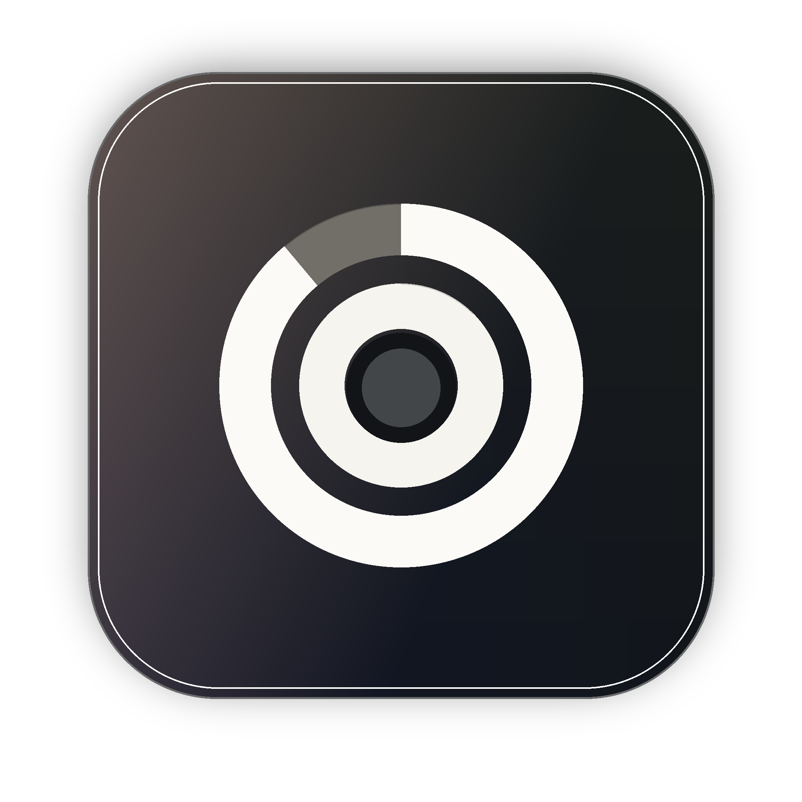
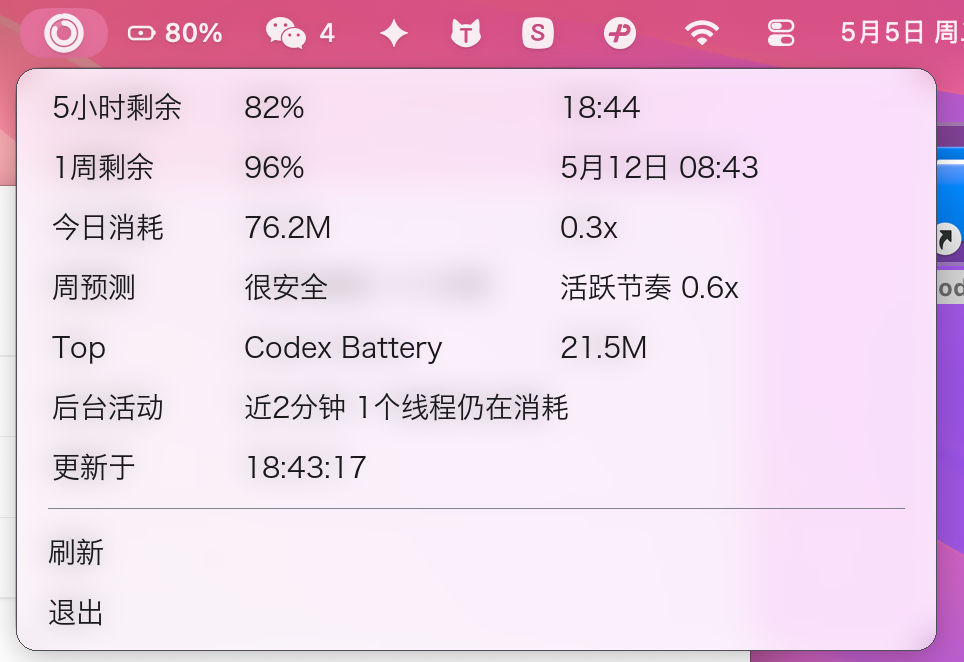
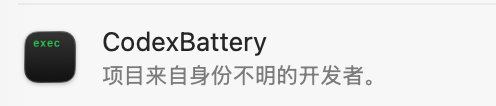

# Codex Battery



一个常驻 macOS 菜单栏的 Codex 额度看板，可选接入 Claude Code 账户额度。



你是不是总是担心 Codex 额度突然用完？

你是不是一边让 agent 干活，一边忍不住反复点开“剩余额度”确认自己还能撑多久？

Codex Battery 就是给“额度不足焦虑症患者”准备的小工具：它把 Codex 额度做成 macOS 状态栏里的电池图标，让你像看电脑电量一样，轻松看到当前消耗情况。

它不只显示剩余额度，还会帮你判断：这一周的额度，按现在的节奏够不够用。

少点几次额度页面，把宝贵的注意力和 token 都留给真正的工作。

Codex Battery 会把 Codex 额度变成一个紧凑的菜单栏信号：

- 额度环会跟随 Codex 实际返回的窗口自动变化：同时有周额度和 5 小时额度时显示双环，仅返回周额度时只显示外环
- 中心骰子点阵：当前可用的完整额度重置次数；图标最多显示六点，Tooltip 保留真实次数
- 图标样式：可从菜单的“图标样式”切换“骰子双环（重置次数）”或“圆环闪电（速度档位）”，选择只保存在本机
- 菜单详情：重置时间、可用完整重置次数及到期日期、今日 token 消耗、额度油耗参考、周预算预测、当前消耗最高的 Codex 对话、近期后台活动、数据生成时间

核心额度和统计来自本机 Codex app-server 及 `~/.codex` 下的状态和日志，不上传本地数据，也不需要网页登录。可选的 Tibo 公告联网检查默认关闭。

## 为什么做这个

长时间用 Codex 做 agentic work 时，额度会变成真实的工作流约束。官方 UI 能看，但不够像电池一样常驻。Codex Battery 的目标很简单：让你不用反复点“剩余额度”，也能知道自己现在是不是安全。

它主要回答：

- 5 小时额度快撞墙了吗？
- 这一周额度能撑到重置吗？
- 今天已经消耗了多少 token？
- 哪个 Codex 对话最耗 token？

如果你在 Codex 侧边栏里给对话改了名，`Top` 行会优先使用本地 session index 里记录的最新名称，而不是继续显示创建时的首条消息摘要。

## 安装

要求：

- macOS 14+
- Xcode Command Line Tools，包含 `swiftc`
- Codex desktop app，并且本机存在 `~/.codex` 状态

### Homebrew

```bash
brew install EOShoow/tap/codex-battery
codex-battery
```

可选：安装登录启动项：

```bash
codex-battery-login install
```

移除登录启动项：

```bash
codex-battery-login uninstall
```

### 源码安装

```bash
git clone https://github.com/EOShoow/codex-battery.git
cd codex-battery
./install.sh
```

应用会安装到：

```text
~/Applications/CodexBattery.app
```

登录启动项会安装到：

```text
~/Library/LaunchAgents/local.codex.battery.menu.plist
```

### 关于“身份不明的开发者”



Codex Battery 目前还没有使用付费 Apple Developer ID 签名，所以 macOS 可能会在“登录项”或 Gatekeeper 提示里显示“身份不明的开发者”。

源码构建会对完整应用包进行本机 ad-hoc 签名，但未使用 Apple Developer ID 签名或公证，因此仍可能出现该提示。

这个提示说的是 Apple 代码签名身份，不等于这个工具会收集你的数据。项目是开源的，会向本机 Codex app-server 询问额度状态，并读取本机 `~/.codex` 下的 Codex 状态和日志作为统计兜底。

如果你比较谨慎，可以先看源码，再用 `./install.sh` 从源码安装。当前 Homebrew formula 也是从这个仓库拉源码后在本机编译，不是下载闭源二进制。

## 菜单怎么读

示例（应用里的周预测会显示为小型趋势图）：

```text
5小时剩余  82%    18:44
1周剩余    96%    5月12日 08:43
可用重置    4次    最近 5月10日到期 ›
今日消耗    76.2M
额度油耗    今日约 4%   本期4% · 常态17%/日
周预测      存在提前用完风险  低 · 常态2期
Top         Codex Battery  21.5M
后台活动    近2分钟 1个线程仍在消耗
数据于      18:43:17
```

图示化周预测包含三条趋势线和一类到期标记：

- 灰色对角线：刚好在重置时用完 100% 的均匀预算线
- 实线：本机 Codex 快照记录的本周真实消耗
- 彩色虚线：预测走势；绿色表示余量舒适，橙色表示接近用完，红色表示预计会提前耗尽

如果有可用完整重置，菜单会单独显示次数。点开该行可查看 API 已返回的每个准确到期日期；如果次数多于有效日期，列表会明确提示还有多少次未返回日期。当前周时间轴范围内最近到期的一批会在预测图上显示橙色竖线和日期，24 小时内到期时改为红色。落在本周额度重置之后的日期仍保留在展开列表里，避免为了显示更远日期而扭曲周预测横轴。如果 app-server 暂时把该字段返回为 `null`，Codex Battery 会短重试一次，并保留最近一次可信次数、标记为“旧数据”；只有明确返回 `0` 才会清零。

预测会把“通常什么时候工作”和“通常多快消耗额度”分开处理：当前 reset 窗口的额度快照合并为 5 分钟桶，此前 28 个完整自然日的 15 分钟活跃桶形成“星期 × 小时”作息画像；历史消耗速度则取近期额度周期的稳健中位数，并优先采用持续至少 3 天的周期，避免短期完整重置冲量主导下一周。当前周期只有形成持续证据后才逐步增加权重；如果历史常态不足，新周期前 12 小时只显示“样本积累中”，不会直接给出确定的提前耗尽日期。

`额度油耗` 是预测背后的事实参考：左侧依据本地可用的最近午夜快照估算今天周额度增加了多少个百分点，右侧显示历史常态日均；Tooltip 还会给出本周期累计值和当前周期直接折算的日均值。Token 数继续单独显示，因为 token 数量和额度百分比没有稳定换算关系。当稳健预测区间跨过 100% 用完线时，菜单只显示橙色风险提示；只有速度证据成熟且整个区间都越线时，才显示红色的确定性提前耗尽结论。

`数据于` 是当前额度快照的时间。正常情况下它来自 Codex app-server 的 `account/rateLimits/read` 返回，和原生 Codex 额度面板更接近；如果首次读取实时额度前这个请求失败，Codex Battery 会回退到本机最新的 `token_count` 事件，此时这个时间就是该事件的生成时间。已经缓存过实时额度后，如果后续刷新失败，它会继续显示上一份实时快照并标记为 `旧数据`，不会再用更旧的 rollout 日志额度覆盖菜单。

如果 5 小时或 1 周窗口的重置时间已经过去，但 Codex 还没有写入新的 usage 事件，Codex Battery 会把这个窗口视为已重置，显示 `100%` 和 `已重置`。

Codex 可能阶段性只返回周额度窗口。此时 Codex Battery 会隐藏不可用的 5 小时行和内环；后续重新返回双窗口时，5 小时行和第二个环会自动恢复。

如果某一行因为太长出现省略号，鼠标悬停可以看到完整内容。

## Claude Code 与额度均衡（实验性）

在「Claude Code」子菜单选择**「仅用本机记录预测（免授权）」**，即可用 Claude Desktop 已写入本机的用量样本更新 5 小时和总周余量。这个模式暂停 Claude 账户检查和桌面界面同步，无需终端登录、钥匙串或 macOS 辅助功能权限。打开菜单和原有定时刷新都会重读文件。若样本超过 15 分钟，菜单标「旧」并暂停总周推算。Claude Desktop 停止采样时，可打开一次 Claude 自带的菜单栏图标。

- **Claude 总周**使用本机最新百分比。周重置时间可手动校准，也可取自本周用量吻合的账户历史。只有连续两周的用量回落都能定位到相近时段时，才自动估计重置时间，面板以「≈」标示。其余情况在积累至少 6 小时样本后，根据最近 24 小时内的读数估算未来 24 小时余量。
- **Fable** 有独立的周限额。本机菜单栏记录只含总周和 5 小时用量。菜单可用同一周匹配的 Fable 历史读数推算，也可在「录入 Fable 周读数…」填写刚看到的已用百分比和它自己的重置时间。悬停可看数据来源和时间。超过 15 分钟的历史推算标「旧」，超过 24 小时暂停，到模型重置后需新读数。

本机来源为 `~/Library/Application Support/Claude/plan-usage-history.json`（当前支持版本 2）。文件缺失或格式变化时，菜单提示等待读数。本模式仅供预测。手动校准按组织保存在本机偏好中。

「启用账户额度检查」和「从 Claude Desktop 同步重置」仍可分别启用。关闭本机预测即可恢复原选项。所有 Claude 功能默认关闭，此时使用原有 Codex 菜单和周趋势图。启用任一项后可以在「图标样式」选择「对半数字」。左侧显示 Codex，右侧显示 Claude。半环表示剩余额度，虚线表示暂未取得读数，数字下划线表示有重置在 3 天内到期。Claude 的数字是可用操作总数，包括完全重置、Fable 等专用重置。

菜单顶部并排显示 Codex 和 Claude Code 的 5 小时、每周剩余额度、可用重置次数、周重置时间及各自数据时间。悬停 5 小时数值可看该窗口重置时间。重置次数在各自的客户端里手动使用。面板显示合计，悬停或在子菜单可看已识别的种类、次数和到期时间，包括 Fable 重置。未取得次数时显示“—”。“对半数字”图标同时显示两家。

选择「从 Claude Desktop 同步重置」后，在 macOS「系统设置 → 隐私与安全 → 设备控制和数据访问」（旧版名称为「辅助功能」）允许 **CodexBattery**，然后打开 **Claude Desktop → 设置 → 使用情况**。看板在 Claude Desktop 位于前台时跟踪用量页，也会在启动或打开菜单时补读已打开的用量页。总数显示在菜单和「对半数字」图标右半边。页面关闭后显示上次同步结果，悬停可看同步时间，已知到期的次数会扣除。重置同步独立于账户额度检查，仅读取界面，重置快照只含次数、识别出的种类、到期时间和同步时间。页面布局或语言变化时可能需要更新识别规则。本地构建换签后，macOS 可能要求重新授权。

在 `Claude Code：未启用` 子菜单选择 `启用账户额度检查`。启用后使用本机已有的 Claude Code 登录，直接向 Anthropic 请求账户用量元数据。额度检查独立于模型任务，无需 API Key。Claude 桌面 App 里的 Code 会话正常运行时，看板使用的本机登录仍可能过期。在终端更新 Claude Code 登录后，后台检查会自动恢复。凭据缺失、过期、无权读取用量或钥匙串暂不可读时分别提示。应用不会自动刷新登录令牌或弹出钥匙串授权。

在账户模式下，账户检查和桌面重置同步都开启且本机 Claude Code 登录过期时，打开 Claude Desktop 的用量页可更新 5 小时、总周和 Fable 剩余额度。检测到过期时会检查已打开的用量页，也可点「立即检查」重读。看板根据用量页显示的上次更新时间估算数据时间，关闭页面后保留当时的读数和时间。页面显示缓存时，菜单沿用原数据时间。回退只读界面，本地只保留百分比和数据时间。周预测区此时仍显示 Claude 和 Fable 的实际用量条。额度比较、配速推算和任务分派等待账户查询恢复。

两家的百分比独立计算，不相加，也不按 token 换算。均衡提示先检查任一窗口是否只剩 10% 或更少，再比较 `周预算余裕 = 剩余百分比 − 距重置天数 × 100/7`；余裕相差至少 10 个百分点且候选方已返回窗口均剩余超过 20% 时，提示下一项任务优先用哪边。这是均匀用量参考，不代表两家算力等价、任务能力或能保证撑到重置。Claude 返回的模型专属周限制（例如 Fable）显示在面板“每周”一格里总额度的后面，如“84% · Fable 70%”，悬停可看重置时间，子菜单也会列出；模型限制紧张或过期时暂停推荐。这类限制来自返回数据 `limits` 列表里按模型划分的行，同样属于非公开格式，读不懂时会暂停建议而不是忽略。

任一方读取失败、快照超过 15 分钟、周窗口缺失或已到重置时间，均衡建议暂停。比较面板对已过期窗口显示「待更新」。应用重启等待检查或本机令牌过期时，显示本周期上次成功读到的 Claude 周额度和同一次查询读到的模型额度，标为「旧」。右半环用较浅的线表示旧数据，悬停可看提示。账户拒绝查询或本机登录缺失时，隐藏账户额度，等待重新登录。最新菜单状态保存在本机私有诊断文件，见隐私说明。

启用后，周配速在 Codex 下方显示 Claude 总周额度和已读取的模型专属周额度，例如 Fable。三者共用本机的活跃时段画像。Claude 和各模型按自己的本周用量及重置时间推算，作息样本不足时暂用本周平均速度。开周不足 6 小时先积累样本。超过 15 分钟未更新或查询失败时，配速条展示上次读数并暂停推算。未使用的模型窗口（0% 且没有重置时间）不显示，也不会暂停均衡建议。账户若返回本周用量分项（如 Claude Code、对话、Cowork），子菜单会列出用量大于 0 的分项及其占周额度的比例；这些是同一周额度的组成部分，不是独立额度，因此不单独显示配速条。

账户额度自动检查随现有刷新和打开菜单进行，成功后至少间隔 5 分钟。空闲调度或睡眠可能延迟检查。手动检查成功后至少间隔 60 秒。请求失败按 5、10、20、40、60 分钟退避。HTTP 429 至少暂停 1 小时，并遵守最长 24 小时的 `Retry-After`。服务器冷却期在开关切换或重启后继续生效。本机凭据读取失败后，至少间隔 5 分钟随现有刷新重新读取，登录更新后自动恢复。手动检查也遵守请求间隔和服务器冷却。沿用现有进程和刷新机制。

账户额度检查使用非公开的 OAuth 用量接口 `https://api.anthropic.com/api/oauth/usage`，返回格式可能变化。接口有时拒绝返回重置明细（原因码 `surface`），此时以桌面同步的读数为准。仅账户用量请求会携带现有访问令牌，服务方会收到你的 IP 和已登录账户发出的请求。账户额度检查默认关闭。

## 统一任务入口（实验性）

启用 Claude 账户额度检查后，打开菜单里的 `新任务：自动分派…`，选择本机工作目录，填写任务，再点击 `开始任务（1 个会话）`。这一操作会使用所选服务的模型额度。默认只读分析，可显式允许修改项目文件；提交前会重新检查额度。模型与推理档位由工具自身设置管理。

自动选择采用上面的均衡规则；没有明显优先方时按上次分派轮换。自动模式要求两边额度都新鲜可信，缺失、过期或余量紧张时暂停；手动指定仅检查被选工具。现阶段不会根据任务内容推断哪个模型更擅长，也不会接管桌面版已有对话。

每次启动一个独立的本机 CLI 会话，最多 15 分钟。同一时间只运行一个由本工具提交的任务；跨应用重启的进程锁防止重复启动。停止、超时或退出应用会终止该会话及其子进程。失败不自动重试、不把同一任务再发给另一家；已经发生的文件修改不会回滚。15 分钟是运行上限，不是 token 或费用上限。

Codex 使用原生只读或项目写入沙箱。Claude 使用 `--restricted` 限制到工作目录和读取/编辑工具，禁用额外 MCP 与自定义 hooks，不开放 Bash；需要执行构建、测试或命令的任务请选择 Codex。两边均不使用跳过全部权限检查的参数。Claude CLI 参数已对本机 `2.1.325` 的帮助核对；其他版本可能需要兼容调整。

结果保存在 `~/Library/Application Support/CodexBattery/tasks/`，可从任务窗口打开。任务记录不创建或续接两款桌面应用里的聊天；各 CLI 使用一次性会话，启动器不会自动安装 CLI 或修改全局配置。继承环境中的常见 API Key 会被移除，但自定义 CLI 配置仍可能影响模型及计费方式；账户额度比较仅适用于相应订阅登录。

## Tibo reset 公告（实验性）

在“Tibo 公告”子菜单打开“省电联网检查（约每 2 小时）”，即可通过 RSS 检查 [Tibo（@thsottiaux）](https://x.com/thsottiaux) 的公开帖子，不需要 X API Key 或登录。支持“立即检查”、设置同账号的自定义 HTTPS RSS 2.0 / Atom 来源，以及恢复默认来源。

默认来源是独立第三方服务 [`nitter.kareem.one/thsottiaux/rss`](https://nitter.kareem.one/thsottiaux/rss)，可能失效、延迟或漏帖；检查失败时保留上次成功结果，单独显示失败状态。如果源中最新帖子已超过 7 天，菜单会提示“来源内容较旧”；抓取成功不代表上游时间线一定最新。

每次成功检查后，2 小时后到期，在下一次现有额度刷新时顺带检查，不增加定时器，也不改变额度刷新节奏。默认活跃 5 分钟、空闲 30 分钟刷新一次，因此实际检查可能稍晚于到期时间；自定义更长间隔或电脑休眠时还会更晚。打开菜单只有在确实触发额度刷新时才提供检查机会。“下次到期（随额度刷新）”显示可检查时间，不是保证执行时刻。

启用功能或更换来源时会立即尝试检查。失败后按 1、2、4、8、12 小时退避，到期后随下一次额度刷新重试；手动检查每分钟最多一次。电脑休眠或应用退出期间不会检查，不为此唤醒电脑，也不补跑错过的次数。借用已有刷新时机减少独立唤醒调度，实际耗电尚未测量。

结果区分“reset 提及”和“reset 预告”，并保留原帖链接。首次成功检查只建立基线，旧帖不会被当成新公告。识别仅依据帖子标题中的独立 `reset` / `resets` 单词，不从“landing tomorrow”这类回复或引用帖推断上下文。公告不代表重置次数已经到账；账号额度和可用重置次数继续以本机 Codex 账号读取结果为准。

## 刷新机制

Codex Battery 会在这些时机刷新：

- 启动时
- 点击 `刷新` 时
- 空闲时每 30 分钟刷新
- 检测到近期 Codex 活动时每 5 分钟刷新
- 刷新失败后每 5 分钟重试

打开菜单时会智能校准官方额度：如果账号额度快照已经超过 60 秒，Codex Battery 会执行一次只读额度刷新；连续打开菜单会按 60 秒防抖，也不会推迟原有后台刷新计划。只有确实需要打开菜单时同步重算今日消耗、Top 和周预测时，才打开 `打开时完整刷新：开`；完整刷新同样限制为每分钟最多一次。

为了避免你从空闲重新开始工作后还卡在 30 分钟等待里，Codex Battery 会额外每 5 分钟跑一次轻量活动探针。这个探针只读本机状态和最近 rollout 日志尾部，不启动 Codex app-server；如果发现从空闲变成活跃，就触发一次账号额度刷新。

活跃期间每 5 分钟的额度刷新只读取官方账号额度；可选的 Tibo 检查启用且到期时，借同一次刷新机会单独请求 RSS。用于计算今日消耗、Top 和周预测的本地详情扫描只在启动、手动刷新以及后台每小时最多一次时运行；最近线程精确读取，旧线程按日期抽样少量日志尾部，用来学习活跃时段而不做全盘扫描。

自动刷新间隔也可以自己填：

```bash
defaults write local.codex.battery.menu activeRefreshMinutes -int 5
defaults write local.codex.battery.menu idleRefreshMinutes -int 30
defaults write local.codex.battery.menu failureRetryMinutes -int 5
defaults write local.codex.battery.menu activityProbeSeconds -int 300
defaults write local.codex.battery.menu detailRefreshMinutes -int 60
```

为了降低功耗，常规额度读取只向本机 Codex app-server 获取当前账号额度；频率更低的详情刷新才会检查最近活跃线程并读取 rollout 尾部，计算今日、Top 和预测统计。

如果后台 Codex 任务仍在运行，菜单会显示 `后台活动` 行，例如 `近2分钟 2 个线程仍在消耗`。这用于提醒你：即使当前对话没有输入，额度也可能因为后台自动化继续变化。

如果 Codex 正在写入、checkpoint 或迁移 `~/.codex/state_5.sqlite`，或本机 app-server 额度读取短暂失败，刷新可能会失败。Codex Battery 会先重试多次；如果之前已经读到过实时额度，就继续显示上一份成功快照，并把检查状态标为 `旧数据`，而不是把整个菜单替换成错误或更旧的 rollout 日志额度。

## 准确性

这是非官方的本地看板。5 小时和 1 周额度优先读取原生 Codex UI 使用的本机 app-server 账号额度路径；今日消耗和 Top 来自本机 rollout 日志。周预测只在本机内存中使用分桶后的活动时间和额度变化，不保存对话正文或标题画像；当 Codex 尚未落盘近期事件时，历史走势仍可能滞后。预测置信度现在反映消耗速度证据，不再只看活跃历史量；它仍然是当前节奏估计，不代表额度保证。

适合当快速仪表盘，不适合作为严格账单来源。

## 兼容性

Codex Battery 依赖 Codex Desktop 的本机 app-server 协议和本地状态格式，主要是 `account/rateLimits/read`、`~/.codex/state_5.sqlite`，以及这个数据库引用的 rollout 日志。

这不是 Codex 官方公开 API。如果未来 Codex Desktop 升级后修改了 app-server 协议、本地数据库结构、日志路径布局，或者 `token_count` 事件格式，Codex Battery 可能会暂时读不到数据，需要更新后才能恢复。

当前已知基线：

- 已在 2026-05-05 的 Codex Desktop `26.429.30905` / app-server 协议上验证
- 已在 2026-05-22 的 Codex Desktop `26.519.31651` 上验证
- 已在 2026-07-10 的 ChatGPT for macOS 内置 Codex 上验证
- 已在 2026-07-14 的 Codex for macOS 单周额度返回结构上验证
- 已在 2026-09-29 的 ChatGPT for macOS `26.924.22138` 上验证实时额度和完整重置次数
- 通过本机 `codex app-server` 的 `account/rateLimits/read` 读取额度
- 支持 `/Applications/ChatGPT.app/Contents/Resources/codex-cli/CodexCLI.app/Contents/MacOS/codex` 内置 app-server，并保留 ChatGPT 和 Codex 应用中旧版 `Contents/Resources/codex` 路径的回退兼容
- 读取 `~/.codex/state_5.sqlite`
- 从 `rateLimitResetCredits.availableCount` 读取可用完整重置次数，并只提取可用 credit 的 `expiresAt` 用于本机日期列表和时间轴标记；临时 `null` 会沿用最近可信次数并标记“旧数据”，从未读到可信次数时中心才留空
- 读取包含 `token_count.rate_limits` 的近期 rollout 日志

如果 Codex 升级后失效，请开 issue，并附上 Codex 版本、macOS 版本、菜单里显示的错误文本。不要直接粘贴私密 rollout 日志；如果必须提供，请先自行检查和脱敏。

## 反馈入口

- 兼容性反馈：[提交兼容性 issue](https://github.com/EOShoow/codex-battery/issues/new?template=compatibility-report.yml)
- Bug 反馈：[提交 bug report](https://github.com/EOShoow/codex-battery/issues/new?template=bug-report.yml)
- 使用问题和安装经验：[GitHub Discussions](https://github.com/EOShoow/codex-battery/discussions)

## 隐私

额度检查不上传你的 rollout 日志、对话内容或本地统计。主动提交任务时，选定的 CLI 会将任务及其读取的相关项目内容发送给对应服务。核心额度读取会启动本机 Codex app-server 并请求 `account/rateLimits/read`；根据 Codex 内部实现，这个 app-server 请求可能会使用你已有的 Codex 登录态访问 Codex/OpenAI，行为类似打开原生额度面板。

它还会在本机读取：

- `~/.codex/state_5.sqlite`
- 该数据库引用的近期 rollout 日志

对话标题只在本机菜单里显示，用于判断哪个对话最耗 token。

Claude 周额度历史保存在 `~/Library/Application Support/CodexBattery/claude-usage-history.json`，权限仅本人可读写，只含周窗口名称、重置时间、检查时间和已用百分比，不含令牌或响应正文；新的一周开始时自动替换旧样本。最新的并排菜单文本、更新时间、当前进程 Claude 请求计数、模型窗口读数、Claude 重置的种类、剩余次数和到期时间（不含重置编号）及上次检查结果码（如 `credential_expired`、`http_401`、`ok`）保存在 `~/Library/Caches/CodexBattery/quota-status.json`，权限为仅本人可读写，用于本机诊断；不含凭据或对话正文，不累计历史。任务输出和状态保存在上面的本机任务目录，可能含项目内容，权限同样限制为本人；分享前请先检查。

Claude 账户检查的网络与凭据范围见上方“Claude Code 与额度均衡”。启用时优先读取 macOS 钥匙串的 `Claude Code-credentials`；条目不存在时回退到本机 `~/.claude/.credentials.json`。只使用现有访问令牌，不调用令牌刷新接口。原始凭据不会写入项目或偏好设置。

实验性 Tibo 公告检查默认关闭。启用后只请求所选公开 RSS 来源，不携带 X API Key、Cookie、本机 Codex 数据或对话日志；来源服务会看到你的 IP 地址和请求的账号。检查记录和公告结果缓存在本机，可随时停用；不增加独立后台服务或服务器。

## 更新

```bash
git pull
./install.sh
```

## 卸载

```bash
./uninstall.sh
```

## 手动构建

```bash
./build.sh
open ~/Applications/CodexBattery.app
```

## 状态

早期版本。Codex 本地状态格式可能变化，欢迎提 issue 或 PR。

## License

MIT
